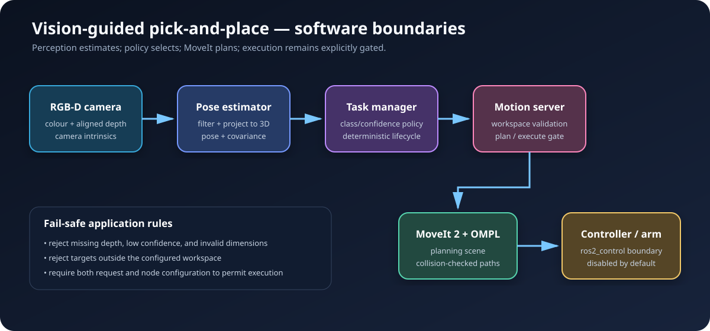
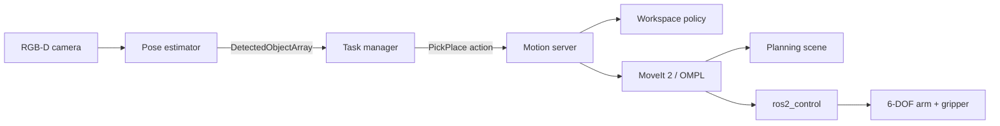

# ROS 2 Vision-Guided Manipulator

[](https://docs.ros.org/en/jazzy/)
[](https://moveit.picknik.ai/)
[](https://github.com/sri1650/ros2-vision-guided-manipulator/actions/workflows/ci.yml)
[](LICENSE)

A production-style ROS 2 manipulation stack that turns RGB-D observations into collision-aware pick-and-place tasks. It combines calibrated 3D perception, explicit task orchestration, MoveIt 2 planning, conservative execution gates, Gazebo scaffolding, and automated verification.

> **Validation status:** core geometry, target-selection, workspace-policy, configuration, and ROS package builds are automated. The robot, MoveIt, RGB-D, and Gazebo integrations are simulation-ready scaffolding and require end-to-end validation on Ubuntu 24.04 with ROS 2 Jazzy. No physical arm, camera, gripper, or safety system has been validated.

## Engineering highlights

- RGB-D pixel-to-3D projection with robust depth sampling and covariance output
- Pluggable perception boundary: deterministic colour segmentation today, learned detector adapter later
- Typed ROS interfaces for detected objects and pick/place actions
- MoveIt 2 planning service with approach, grasp, transfer, and retreat stages
- Workspace, confidence, dimensions, and execution-authorisation checks before motion
- Plan-only default so a demo cannot command hardware accidentally
- Six-axis arm, parallel gripper, RGB-D camera, ros2_control, SRDF, and OMPL configuration
- Deterministic task state machine with cancellation and failure reporting
- C++, Python, configuration, and package tests in GitHub Actions
- Docker and VS Code dev-container workflow for repeatable setup

## Architecture





See [architecture.md](docs/architecture.md) for ownership, interfaces, coordinate frames, and failure handling.

## Packages

| Package | Language | Responsibility |
|---|---|---|
| `vgm_interfaces` | ROS IDL | Detected-object messages and pick/place action contract |
| `vgm_perception` | Python | RGB-D segmentation, depth filtering, 3D projection, object publishing |
| `vgm_motion` | C++ | Request validation, MoveIt planning, gated execution, action feedback |
| `vgm_task_manager` | Python | Target selection and manipulation task lifecycle |
| `vgm_description` | Xacro/URDF | Six-axis arm, gripper, camera, and ros2_control model |
| `vgm_moveit_config` | SRDF/YAML | Planning groups, kinematics, limits, OMPL, and controllers |
| `vgm_bringup` | Launch/YAML | Application configuration and Gazebo demo composition |

## Quick start

The simplest path is VS Code **Dev Containers: Reopen in Container**. For a native setup, use Ubuntu 24.04 with ROS 2 Jazzy, MoveIt 2, Gazebo Harmonic, and ros2_control.

```bash
git clone https://github.com/sri1650/ros2-vision-guided-manipulator.git
cd ros2-vision-guided-manipulator
rosdep install --from-paths src --ignore-src -r -y
colcon build --symlink-install --cmake-args -DCMAKE_BUILD_TYPE=RelWithDebInfo
source install/setup.bash
ros2 launch vgm_bringup demo.launch.py plan_only:=true
```

`plan_only:=true` is intentional. Change it only after inspecting the model, planning scene, controller mapping, and emergency-stop arrangement for the target system.

Run verification:

```bash
colcon test --event-handlers console_direct+
colcon test-result --verbose
```

## Demo flow

1. Gazebo presents a tabletop workpiece to the virtual RGB-D camera.
2. Perception filters depth samples and publishes a 3D object pose with uncertainty.
3. The task manager selects the best matching target above its confidence threshold.
4. The motion server validates the request and computes approach/transfer plans.
5. In plan-only mode, the action reports readiness without moving hardware.
6. With an explicitly enabled, validated controller, the same interface can execute the trajectory.

The detailed walkthrough and expected topics are in [demo.md](docs/demo.md).

## Evidence and limitations

- [Verification plan and current evidence](docs/verification.md)
- [Simulation setup and acceptance criteria](docs/simulation.md)
- [Physical integration and commissioning plan](docs/hardware-integration.md)
- [Architecture decision records](docs/decisions/0001-plan-only-default.md)

This repository demonstrates software engineering practices; it is not a certified functional-safety system. A real cell requires guarding, safe torque off, a safety-rated controller, risk assessment, stopping-distance validation, and supervised commissioning.

## Roadmap

- [ ] Record the first Gazebo/MoveIt acceptance run and attach screenshots/rosbags
- [ ] Add AprilTag and ONNX detector adapters behind the perception interface
- [ ] Add grasp-candidate scoring and collision-object mesh generation
- [ ] Add hand-eye calibration workflow and calibration-quality report
- [ ] Add hardware-in-the-loop controller tests
- [ ] Validate repeatability, cycle time, pose error, and recovery behaviour on a physical arm

## License

MIT. See [LICENSE](LICENSE).

